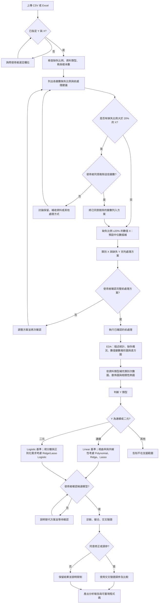

# 迴歸分析決策樹

主流程依序為：上傳 CSV/Excel → 指定 Y/X → 資料檢查 → 確認前處理 → EDA 探索性資料分析 → 判斷 Y 類型 → 推薦模型 → 確認候選模型 → 診斷／擬合／交叉驗證 → 確認是否修正或調參 → 輸出分析報告與可重現程式碼。

## 操作原則

- **缺失比例以各欄位分別計算**：缺失筆數 ÷ 全部筆數；恰好 20% 歸入插補。
- **數值型 X 缺失比例 ≤20%**：預設採中位數插補，列入前處理方案供使用者確認。
- **X 缺失比例 >20%**：列出變數名稱、缺失比例與刪除後影響，經使用者明確同意後才刪除；不同意時討論替代方案。
- **類別型 X 不使用中位數插補**：另提眾數或「缺失」類別等方案供確認。數字編碼的類別變數仍視為類別型。
- **Y 缺失不套用 X 的插補或刪變數規則**：另行確認是否排除缺失 Y 的資料列，或補收資料。
- **EDA 放在前處理後、判斷 Y 類型前**：呈現描述統計、箱形圖、直方圖，並依資料適用性加入類別次數圖、散佈圖與相關性熱圖。箱形圖出現離群點時僅標示與說明，不自動刪除。
- **避免資料洩漏**：建模與交叉驗證時，中位數等前處理參數只從訓練資料估計，再套用到驗證或測試資料；每個交叉驗證切分皆重新估計。
- **需使用者確認的決策才詢問**；Y 類型等可由資料判定的分支，若語意不明才請使用者澄清。
- 未經授權不得擅自刪資料、修改變數、調參或更換模型。輸出前確認資料處理紀錄、EDA、方法、評估指標、套件版本與重現程式碼齊全。
